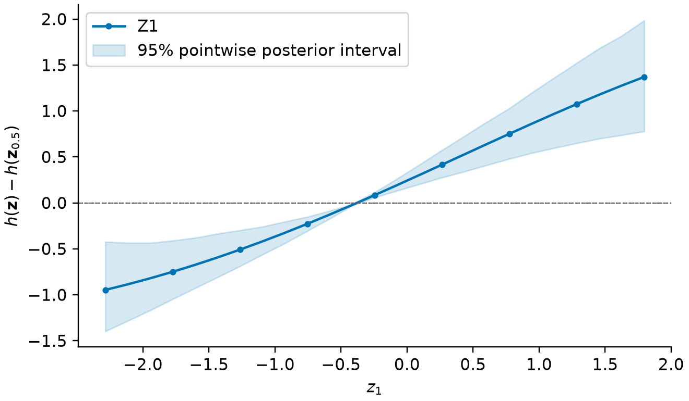

# KernelMix

Bayesian kernel machine regression (BKMR) for exposure mixtures in Python.
KernelMix estimates a flexible exposure–response function, with linear adjustment
for covariates. It supports continuous, binary, count and right-censored survival outcomes,
with Gaussian random intercepts for clustered observations. NumPy and SciPy handle fitting and prediction; R is not required.

| Analysis | Functions |
| --- | --- |
| Fit outcomes | `fit`, `Prior`: Gaussian, probit, Poisson, negative binomial and piecewise-exponential survival |
| Cluster observations | `cluster`, `random_intercepts`, known/new-cluster prediction |
| Select exposures or exposure groups | `selection="component"` or `"group"`, posterior inclusion probabilities |
| Inspect results | `summary`, `diagnostics`, `posterior_samples` |
| Predict | `predict_h`, `predict`, `predict_survival`, `posterior_moments_h` |
| Describe exposure associations | Overall, single-exposure and interaction contrasts; response curves and surfaces |
| Plot | Chains, inclusion probabilities, exposure curves, survival curves, contrasts and surfaces |

## Install

With access to this repository:

```sh
python -m pip install "kernelmix[plots] @ git+https://github.com/nilson01/kernelmix.git@work/count-survival-clusters"
```

Or, from a downloaded source folder:

```sh
python -m pip install ".[plots]"
```

Python 3.10 or later is required. Omit `[plots]` if plots are not needed.

## Example

```python
import numpy as np
from kernelmix import fit, univariate_response, plot_response

rng = np.random.default_rng(17)
Z = rng.normal(size=(24, 2))
y = np.sin(Z[:, 0]) + 0.3 * Z[:, 1] + rng.normal(0, 0.5, 24)
result = fit(y, Z, draws=200, warmup=200, chains=2, seed=17)
print(result.summary())
curve = univariate_response(result, variable=0, points=25, seed=17)
ax = plot_response(curve)
```

Example output (first rows):

```text
BKMRFit(family='gaussian', n=24, exposures=2, chains=2, draws=200)
95% pointwise credible intervals
Parameter             Mean         SD      Lower      Upper
lambda               16.93      9.047      4.145      38.61
sigma2              0.2159    0.08346     0.1142     0.4188
```

These short chains trigger mixing warnings. This example demonstrates the workflow.
Choose chain lengths using mixing,
effective sample size and the precision needed for the analysis.



The curve holds the second exposure at its sample median and subtracts the
all-median reference. It shows an association, not an identified causal effect.

## Documentation

- [Tutorial](docs/tutorial.md): data, fitting, prediction and plots.
- [API](docs/api.md): grouped functions, inputs and returned values.
- [Model and interpretation](docs/methods.md): equations, priors and limits.
- [Reference manual](docs/manual.pdf): printable documentation.
- [Checks and development](docs/development.md): tests and installed-R comparisons.

Dense covariance calculations limit practical sample size. The Gaussian kernel
is used for every family. Survival fitting uses a full event-time likelihood
with a piecewise-constant baseline hazard and independent right censoring. Group selection allows at most one selected exposure per
group. Diagnostics cannot establish convergence or validate model assumptions.

## References and license

The method is due to [Bobb et al. (2015)](https://doi.org/10.1093/biostatistics/kxu058).
The software and binary-outcome extension are described by
[Bobb et al. (2018)](https://doi.org/10.1186/s12940-018-0413-y).
KernelMix is a separate Python implementation. Selected Gaussian/probit calculations, including random intercepts, are checked
against R [`bkmr`](https://cran.r-project.org/package=bkmr) 0.2.2.
See [NOTICE](NOTICE) for attribution and [LICENSE](LICENSE) for GPL-2.0-only terms.


Count and survival likelihoods use additional standard model ingredients,
separately from R `bkmr`. Their definitions and checks are in the model guide.
New-family default amplitude priors differ from the Gaussian/probit defaults.
