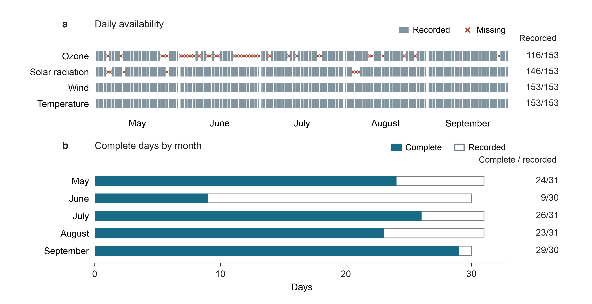
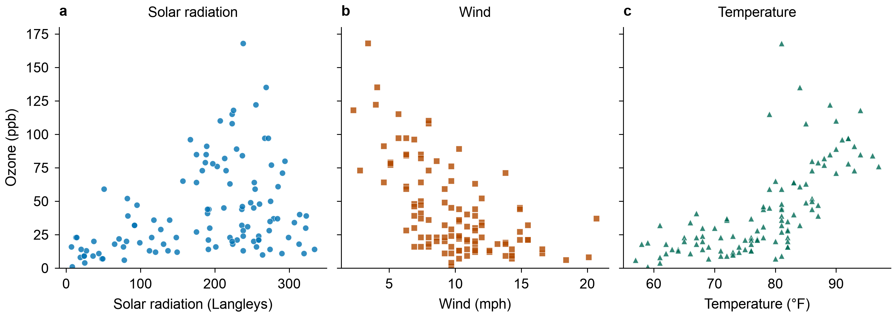
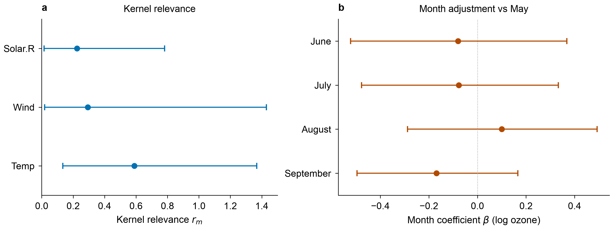
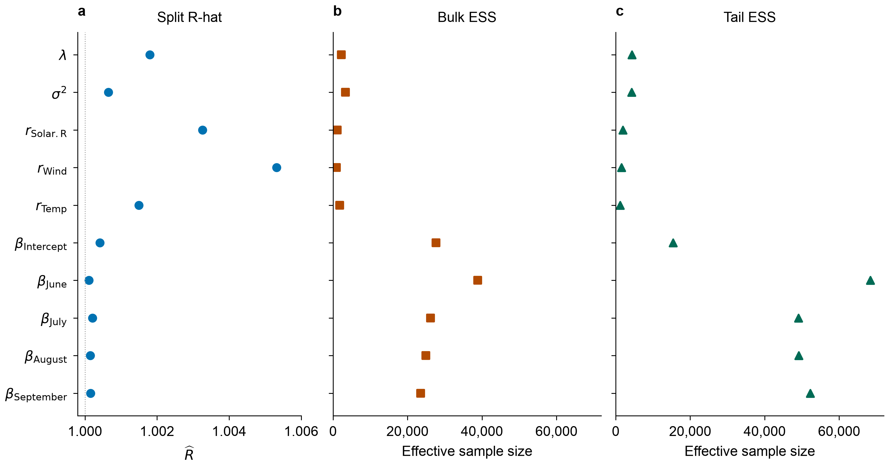

# Ozone and weather in New York

We examine how daily ozone varies with solar radiation, wind and temperature, adjusting for month. This exploratory analysis uses the public New York air-quality data, separately from the applications in Bobb et al. (2015). Source data, saved results and sampling checks accompany the example.

## Data and question

The [R airquality data](https://stat.ethz.ch/R-manual/R-devel/library/datasets/html/airquality.html) contain 153 daily records from New York, May–September 1973. Ozone was measured at Roosevelt Island, solar radiation at Central Park, and wind and temperature at LaGuardia Airport. Their measurement times also differ. These are daily environmental measurements, not personal exposures.

| Variable | Role | Unit |
| --- | --- | --- |
| `Ozone` | Outcome, transformed with the natural logarithm | Parts per billion |
| `Solar.R` | Exposure function | Langleys |
| `Wind` | Exposure function | Miles per hour |
| `Temp` | Exposure function | Degrees Fahrenheit |
| `Month` | Linear adjustment, May as reference | Four indicators |

There are 37 missing ozone values and seven missing solar-radiation values. Keeping only rows with all required values retains 111 days and excludes 42. No missing values are filled in. The [source CSV](data/airquality.csv) preserves all 153 records. Its [provenance](data/airquality-provenance.json) records the R version, hash, units and excluded row numbers.

| Month | Recorded days | Complete days |
| --- | --- | --- |
| May | 31 | 24 |
| June | 30 | 9 |
| July | 31 | 26 |
| August | 31 | 23 |
| September | 30 | 29 |

Ozone medians are 31 ppb in complete rows and 35 ppb in the five rows missing
solar radiation. Missingness is uneven across months, and ozone is unknown on
37 days. These observed ozone values do not show whether excluding incomplete days leaves the analysis unbiased.





## Model and run

We use the Gaussian BKMR model with $Y_i=\log(\mathrm{Ozone}_i)$, $\mathbf z_i$ containing solar radiation, wind and temperature, and $\mathbf x_i$ containing an intercept and four month indicators:

$$Y_i=h(\mathbf z_i)+\mathbf x_i^\mathsf T\boldsymbol\beta+\epsilon_i,\qquad
\epsilon_i\overset{\mathrm{iid}}{\sim}N(0,\sigma^2).$$

We standardize each exposure using the mean and sample standard deviation of the 111 retained days. Month indicators describe broad seasonality; independent errors remain a working assumption for this daily series.

For the Gaussian kernel, independent $r_m\sim\mathrm{Gamma}(1,1)$ priors use shape and rate one. Residual variance has an inverse-gamma(2,1) prior. We retain the default flat prior for adjustment coefficients and $\lambda=\tau/\sigma^2\sim\mathrm{Gamma}(1,0.1)$. Here $\tau$ is the GP covariance amplitude and $\sigma^2$ the residual variance. Exposure selection is disabled.

From the source folder, with KernelMix and its plotting extra installed:

```sh
python tools/analyze_airquality.py --draws 20000 --warmup 5000 --output ozone-results
python tools/plot_airquality.py --results ozone-results --output ozone-figure
```

Four chains run sequentially with seed 73. Each has 5,000 warmup iterations and 20,000 saved draws. An initial 4,000-draw run had maximum $\widehat R=1.0142$; one longer run was made to improve sampling, with the model, prior and data unchanged. This is an exploratory workflow, not a prospectively fixed study.

## Results and checks

| Check | Recorded result |
| --- | --- |
| Maximum rank/folded split $\widehat R$ | 1.0053 |
| Minimum bulk effective sample size | 885 |
| Minimum tail effective sample size | 1,193 |
| Consecutive-day residual pairs | 92 |
| Correlation of consecutive-day fitted residuals | 0.0136 |
| Fitting time on the recorded local environment | 72.6 seconds |

Sampling diagnostics use all saved draws for ten parameters. R-hat compares chains; effective sample size accounts for dependence between draws. These parameter diagnostics do not establish convergence of every estimated curve. Curve and fitted-residual summaries use 400 evenly spaced draws per chain.

Residual checks use training data, not held-out observations. The consecutive-day residual correlation cannot establish independent errors.


To isolate a conditional weather association, each curve varies one exposure with the others at their medians. The mean curve generally rises with temperature and falls with wind; the solar-radiation curve is nonlinear. On the log scale, exponentiating a difference gives a ratio of fitted ozone medians at fixed weather and month values, not an arithmetic mean difference.

Each grid spans the 5th–95th percentiles, with duplicate values removed. Combining a grid value with the other exposures' medians may produce a profile uncommon in the observed data. The [curve table](results/airquality/curves.csv) records its distance to the nearest observed profile after standardization; the distance plot below shows how close these combinations are to the data.

### Parameter estimates

The kernel relevance parameters $r_m$ describe how exposure differences change the covariance of $h$. The month coefficients $\boldsymbol\beta$ instead describe differences from May on the log-ozone scale. Points show posterior means; bars show 95% equal-tailed credible intervals.



### Sampling checks

To assess the sampling behind these intervals, we show diagnostics for all ten parameters. Bulk effective sample size concerns the center of the posterior; tail effective sample size concerns its tails.



### Distance from observed exposure combinations

Sampling checks do not show whether a curve profile occurs in the data. We therefore measure its distance to the nearest observed profile, using training standard deviations to put exposures on a common scale. No distance cutoff establishes prediction reliability.


The [plotting script](../tools/plot_airquality_details.py) regenerates these five additional figures from saved tables without refitting:

```sh
python tools/plot_airquality_details.py
```

## Reuse and limits

The [results record](results/airquality/results.json), [parameter summaries](results/airquality/parameters.csv), [diagnostics](results/airquality/diagnostics.csv), [curve values](results/airquality/curves.csv) and [dated observations/residuals](results/airquality/observations.csv) accompany the runnable scripts. R is not required to run the analysis. Maintainers can regenerate the source CSV with `Rscript tools/export_airquality.R destination.csv`; the recorded export uses R 4.5.0.

Missingness, measurement differences, priors and serial dependence limit
interpretation. This example establishes neither causal effects nor time-series
interval coverage. Original-study reproduction and external research use remain
separate evidence gaps; see [reference studies](reproduction.md).
